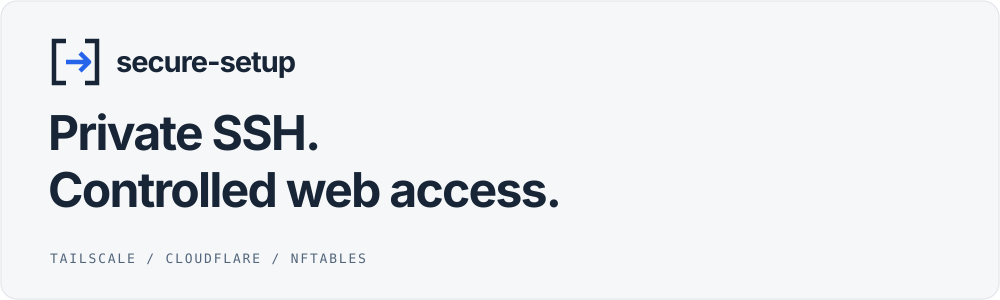
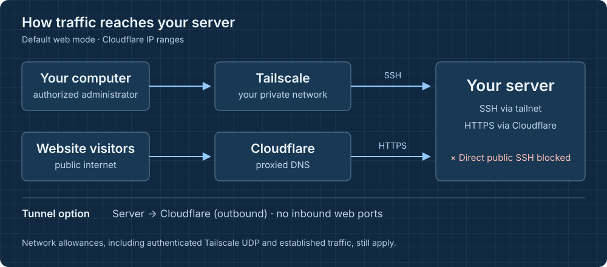
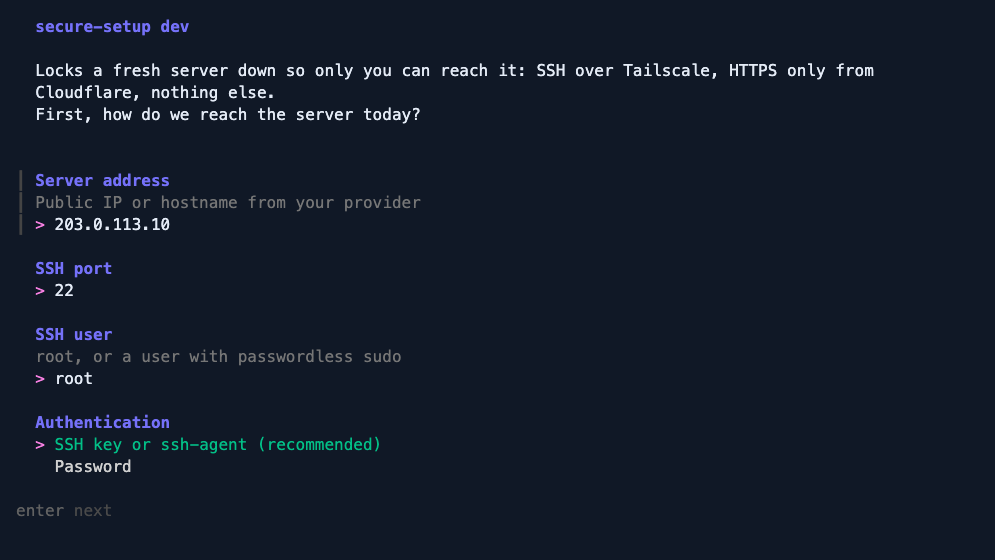

<p align="center">
  <picture>
    <source media="(prefers-color-scheme: dark)" srcset="docs/assets/header-dark.svg">
    
  </picture>
</p>

<p align="center">
  <a href="https://github.com/niklas-schmidt-dev/secure-setup/releases"></a>
  <a href="https://github.com/niklas-schmidt-dev/secure-setup/actions/workflows/ci.yml"></a>
  <a href="LICENSE"></a>
</p>

secure-setup is a guided CLI for restricting access to a fresh Linux server.
It puts SSH behind Tailscale, limits web access to Cloudflare or a Cloudflare
Tunnel, and checks the new firewall before keeping it. Run it from your
computer or directly on the server.

[Get started](#get-started) · [How it works](#how-it-works) · [Commands](#commands) · [Security](SECURITY.md)

## What you get

- **Private administration.** Move SSH onto your tailnet and block new SSH
  connections to the server's public address.
- **A choice of web access.** Allow web ports only from Cloudflare's published
  IP ranges, use an outbound Cloudflare Tunnel, or close web access entirely.
- **A check before changes become permanent.** A rollback timer restores the
  previous firewall if the new rules are not confirmed in time.
- **Repeatable setup.** Save the wizard's answers as a JSON plan. Passwords,
  auth keys and tunnel tokens are excluded from the saved plan.

## Access at a glance



The diagram shows the default Cloudflare IP-range mode. Your tailnet's access
policy still controls who can reach private SSH. Required network traffic,
established connections and authenticated Tailscale UDP are separate firewall
allowances; see [the complete network policy](docs/networking.md).

## Before you start

For the recommended setup from your computer, have:

- A fresh Linux server running systemd and a supported package manager:
  apt-get, dnf, yum, pacman or zypper.
- The server's address, SSH port and credentials. Use root or an account with
  passwordless sudo. Keep your provider's recovery console available.
- A macOS or Linux computer connected to the Tailscale network you want the
  server to join. On Windows, use WSL with working tailnet connectivity.
- A local SSH key, or access to an SSH agent. The wizard can use a password
  for the first connection, then install and verify your public key.
- A Cloudflare-managed hostname if you want to serve a website through
  Cloudflare. You do not need one when choosing no web traffic.

The wizard proposes system package updates and a reboot by default. Review
both choices before applying the plan. This tool changes the server's
firewall and SSH configuration; it is intended for a fresh server.

## Get started

### 1. Start the wizard on your computer

Run this in an interactive terminal on your computer:

```sh
sh -c "$(curl -fsSL https://raw.githubusercontent.com/niklas-schmidt-dev/secure-setup/main/install.sh)"
```

This downloads and runs the installer, which installs the release binary and
opens the wizard. You can [read the installer](install.sh)
before running it. Running from your computer lets secure-setup test a new
private SSH connection and check public SSH from outside the server.

### 2. Connect to the server



*The real connection screen from a local development build. The example
address was entered without connecting to a server.*

Enter the server's public address, SSH port and user. Choose an SSH key or
ssh-agent, or use a password for the initial login. For a new host, check the
host key fingerprint against a trusted source before accepting it.

The account must be root or have passwordless sudo. With SSH hardening
enabled, secure-setup installs and tests your public key before disabling
password login.

### 3. Join your tailnet

Choose a name for the server. Provide a Tailscale auth key, or leave the field
empty and follow the login link. Your computer and the server must be able
to reach each other through the intended tailnet.

Standard SSH with your key is the default. Tailscale SSH is an optional
choice that uses your tailnet identity and access policy.

### 4. Choose how web traffic reaches the server

| Mode | Result | What to prepare |
| --- | --- | --- |
| Cloudflare IP ranges | HTTPS on port 443 is accepted only from Cloudflare's published ranges. Port 80 is optional. | A proxied DNS record and Full (strict) SSL mode, with an origin certificate that satisfies it. |
| Cloudflare Tunnel | The server connects out to Cloudflare; no inbound web port is opened. | Create a tunnel and paste its token or service-install command into the wizard. Route the hostname to your service after it connects. |
| No web traffic | No inbound web port is allowed. | Nothing extra. |

Cloudflare's IP ranges are shared across customers. An IP allowlist alone
does not identify your zone; see the [security notes](SECURITY.md)
and [networking guide](docs/networking.md#cloudflare-ip-ranges) for
origin authentication and the tunnel option.

For a tunnel, follow the [complete tunnel walkthrough](docs/networking.md#cloudflare-tunnel).
Tunnel hostnames are public unless you protect them. Put Cloudflare Access
in front of services intended only for you.
secure-setup configures access to your service; prepare the application, DNS
record and origin TLS configuration for the web mode you choose.

### 5. Review, apply and verify

Review the selected ports, SSH hardening, updates, reboot and rollback window.
When you apply the plan, secure-setup validates the rules, arms the rollback
timer and loads the firewall.

It then opens a fresh SSH connection over the tailnet. After that connection
confirms the setup, the timer is cancelled and the rules are persisted. It
also checks that a new connection to public SSH is blocked. If you keep the
reboot enabled, it reconnects and checks the configuration again after boot.

If confirmation fails before the timer expires, the previous firewall is
restored. The rollback window does not cover the later reboot. Keep provider
console access available for boot failures or private-network policy issues.

After setup, connect using the tailnet address shown in the result:

```sh
ssh YOUR_USER@YOUR_TAILNET_IP
```

Replace both placeholders. Add `-p YOUR_SSH_PORT` if you use a non-default port.
An existing public SSH session may remain open; the relevant check is whether
a *new* public connection is blocked.

## Other setup paths

### Already logged in to the server?

Run this as root in the server's terminal:

```sh
curl -fsSL https://raw.githubusercontent.com/niklas-schmidt-dev/secure-setup/main/install.sh | sh -s -- here
```

While the rollback timer is running, log in from another device over the
tailnet. When using Tailscale SSH, run `secure-setup confirm` in that new
session. If sudo removes `SSH_CONNECTION`, use
`sudo --preserve-env=SSH_CONNECTION secure-setup confirm`.

A local run cannot check its own public SSH exposure from outside. Test a new
connection from another machine:

```sh
nc -zv YOUR_PUBLIC_IP 22
```

Replace the address and port. The new connection must fail; also confirm that
private SSH succeeds. After a local run's reboot, inspect
`/var/log/secure-setup-bootcheck.log` for the boot check result.

### Automating first boot?

Start with the [cloud-init example](examples/cloud-init.yaml).
Unattended setup needs a Tailscale auth key and uses self-checks. These cannot
prove that your tailnet's access policy allows an inbound SSH connection.
Until setup succeeds, the server keeps the exposure of its provider image.
Check `/var/log/secure-setup-firstboot.log` and verify access from outside.

<a id="how-the-rollback-works"></a>

## How it works

The default policy moves SSH to `tailscale0`, allows HTTPS only from
Cloudflare's published ranges, and drops other unsolicited inbound traffic
except the explicit network allowances below. The tunnel option replaces
the open web port with an outbound connection.

- Loopback, established and related traffic, required ICMP and DHCP replies
  are allowed. Ping is optional and rate limited.
- UDP 41641 stays open for authenticated direct Tailscale connections.
- Extra private ports are configurable. Outbound traffic is allowed.
- Docker's own rules remain in place. Forwarded traffic from public uplinks
  is restricted to Cloudflare on the allowed web ports; private-side traffic
  is handled separately.

The firewall confirmation flow is:

1. Validate the candidate rules and save the previous firewall state.
2. Arm a systemd rollback timer for the window selected in the wizard
   (60 seconds, 2 minutes or 5 minutes).
3. Apply the new rules atomically.
4. Confirm new private access, or use the selected local confirmation mode.
5. Cancel rollback and persist the rules after confirmation.

Preview the rules from a saved plan before applying them:

```sh
secure-setup render -f plan.json
```

<a id="use"></a>

## Commands

| Command | Purpose |
| --- | --- |
| `secure-setup` | Start the remote setup wizard on your computer. |
| `secure-setup here` | Start the wizard on the Linux server itself. |
| `secure-setup apply -f plan.json` | Apply a saved plan; add `--yes` for unattended confirmation of prompts. |
| `secure-setup here -f plan.json` | Apply a saved plan locally. |
| `secure-setup here --yes` | Run locally with defaults and self-checks. |
| `secure-setup confirm` | Confirm a waiting local setup from a new private SSH session. |
| `secure-setup render -f plan.json` | Print the generated nftables ruleset. |
| `secure-setup undo --host YOUR_TAILNET_IP` | Undo secure-setup's firewall and SSH changes over SSH. |
| `secure-setup undo --here` | Undo the changes from the server itself. |

The wizard saves remote plans to `~/.config/secure-setup/<host>.json` and local
plans to `/etc/secure-setup/plan.json`. Edit the target before reusing a remote
plan on a different server. Non-interactive secrets come from
`SECURE_SETUP_PASSWORD`, `SECURE_SETUP_PASSPHRASE`, `TS_AUTHKEY` and
`CLOUDFLARE_TUNNEL_TOKEN`.

See the [plan and configuration reference](docs/reference.md) for replaying
plans, interface detection and non-interactive options. With remote
<code>apply --yes</code>, first-seen host keys are accepted automatically;
changed or invalid known host keys are still refused.

<a id="install"></a>

## Installation details

The installer supports macOS and Linux on amd64 and arm64. It installs into
`/usr/local/bin` as root or `~/.local/bin` otherwise. If `~/.local/bin` is not
on your PATH, add it or use the full binary path shown by the installer.

Set `SECURE_SETUP_NO_RUN=1` to install without starting the wizard,
`SECURE_SETUP_VERSION` to pin a release, or `SECURE_SETUP_INSTALL_DIR` to
choose the destination. Archives are also available from
[GitHub Releases](https://github.com/niklas-schmidt-dev/secure-setup/releases).

Downloads are checked against the release's SHA-256 checksums. With a
compatible GitHub CLI installed, the installer also verifies signed build
provenance. Without it, provenance is not checked. Checksums from the same
release detect corruption, not replacement of the release itself. Releases
through v0.4.0 have no provenance; `SECURE_SETUP_NO_PROVENANCE=1` explicitly
skips that check.

<details>
<summary>Verify a release archive manually</summary>

Download the archive and <code>provenance.json</code> from the same release,
then run:

```sh
gh attestation verify secure-setup_linux_amd64.tar.gz \
  --repo niklas-schmidt-dev/secure-setup \
  --signer-workflow niklas-schmidt-dev/secure-setup/.github/workflows/release.yml \
  --bundle provenance.json
```

The bundle permits verification without a GitHub login. Use the filename of
the archive for your platform.

</details>

To build and install from source, use the Go version required by
[go.mod](https://github.com/niklas-schmidt-dev/secure-setup/blob/main/go.mod)
(currently Go 1.27.3 or newer):

```sh
go install github.com/niklas-schmidt-dev/secure-setup@latest
```

## Recovery and limits

Rollback covers the firewall confirmation window, not the subsequent reboot
or every change made during setup. It does not revert package upgrades.
Unattended self-checks do not prove inbound tailnet access. Keep your provider
console available if a boot check or private login fails.

`undo` removes secure-setup's firewall, timers and SSH hardening changes and
leaves Tailscale installed. It can make the server publicly reachable again.
Review its prompt before continuing. A previously retired ufw is re-enabled;
firewalld is unmasked but must be started manually.

For the detailed threat model and private vulnerability reporting, read
[SECURITY.md](SECURITY.md).

For confirmation modes, boot-check logs and recovery commands, see the
[recovery guide](docs/recovery.md).

<a id="things-worth-knowing"></a>

## Documentation

| Guide | What it covers |
| --- | --- |
| [Networking](docs/networking.md) | Cloudflare IP ranges and tunnels, Docker, Tailscale SSH and existing private networks. |
| [Reference](docs/reference.md) | Saved plans, environment variables, supported platforms and server changes. |
| [Recovery](docs/recovery.md) | Confirmation modes, rollback, reboot checks and undo. |
| [Security](SECURITY.md) | Threat model, release provenance and private vulnerability reporting. |
| [Cloud-init example](examples/cloud-init.yaml) | Unattended first-boot setup. |

### What ends up on the server

secure-setup installs an nftables ruleset, an SSH configuration drop-in and
the services needed by your selected setup. The [server file and service
inventory](docs/reference.md#what-ends-up-on-the-server) lists their paths,
backups and interaction with ufw or firewalld.

## Development

Start with [CONTRIBUTING.md](CONTRIBUTING.md) for the repository layout,
unit tests, real-nft validation and the disposable Debian end-to-end tests.
The e2e environment exercises both setup modes and forced rollback; it is
not a test matrix for every supported distribution or cloud provider.

For a vulnerability, use [private reporting](SECURITY.md#reporting-a-vulnerability).

## License

[MIT](LICENSE) · Niklas Schmidt
