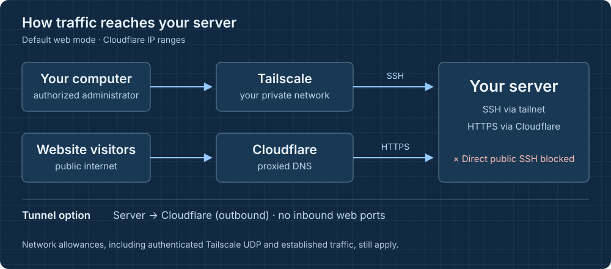

# Networking

[Back to the README](../README.md) · [Reference](reference.md) · [Recovery](recovery.md)



## Cloudflare IP ranges

The default web mode accepts TCP 443 only from Cloudflare's published IPv4
and IPv6 ranges. The wizard can also allow port 80. Proxy the DNS record in
Cloudflare (the orange cloud), use Full (strict) SSL mode and configure an
origin certificate that satisfies it. The daily
`secure-setup-cloudflare-sync.timer` refreshes the address ranges.

Cloudflare's ranges are shared across customers. Allowlisting them alone
does not identify your account. Global Authenticated Origin Pulls also uses
a shared Cloudflare certificate; for account-specific authentication, use
zone-level or per-hostname AOP with your own certificate and configure the
origin to verify it. See [Cloudflare's AOP guidance](https://developers.cloudflare.com/ssl/origin-configuration/authenticated-origin-pull/).

## Cloudflare Tunnel

In tunnel mode, cloudflared connects out to Cloudflare. No inbound web port
is opened. SSH continues to use the private network.

1. In the Cloudflare dashboard, create a Cloudflared tunnel. The location
   is shown as **Networks → Tunnels** in the wizard's instructions.
2. On the tunnel's installation page, copy the **Install as service** command
   (`sudo cloudflared service install eyJ...`). Do not run it separately.
3. Choose **Cloudflare Tunnel** in the secure-setup wizard and paste that
   command into the token field. The bare token works too. For a saved
   plan, set `"cloudflare_tunnel": true`, leave `web_ports` empty and supply
   `CLOUDFLARE_TUNNEL_TOKEN` through the environment.
4. Continue secure-setup. It installs cloudflared if needed and starts the
   tunnel. The Cloudflare page may wait for the connection before allowing
   you to continue; finish this connection step in secure-setup first.
5. Once connected, continue in Cloudflare and route the hostname to your
   local service, for example `http://localhost:8080`.

What you route is public: scanners can probe a new hostname immediately.
Put Cloudflare Access (Zero Trust → Access) in front of anything that is
only for you.

The token is stored in `/etc/secure-setup/cloudflared.token` with mode 0600.
`secure-setup-cloudflared.service` reads it with `--token-file`; it is not
put on the service's command line. The run continues to the firewall only
after the tunnel connects. The reboot check also expects it to reconnect.

The installer uses Cloudflare's package repository on apt-get/dnf/yum
systems and the distribution package on pacman. On other package managers,
install cloudflared yourself before running tunnel setup. On a rerun, an
empty token field keeps the stored token. A plan that no longer uses a
tunnel removes the earlier secure-setup tunnel service and token.

## No web traffic

Choose **No web traffic at all** to omit inbound web allowances. Extra
ports can still be made reachable from the tailnet. This does not disable
the explicit network allowances listed below.

## The default firewall policy

- inbound default: drop
- loopback, established and related connections, the ICMP types networks need, DHCP replies: accept
- ping: accept with a rate limit (optional)
- UDP 41641 from anywhere: accept (direct Tailscale connections; authenticated WireGuard)
- SSH and any extra ports you chose, only on `tailscale0`: accept (with a counter: `nft list chain inet secure_setup input` shows how many connections came in this way). With an [existing private network](#existing-private-networks), only to its `admin_address` on its interface
- TCP 443 (and 80 if chosen), only from Cloudflare's ranges: accept
- forwarded traffic (Docker, VMs): allowed from inside, allowed from the internet only through Cloudflare on the web ports. "The internet" is every interface with a default route, IPv4 or IPv6, every network card with a public address, such as a second public NIC without a default route, a VLAN, bond or bridge on top of such a card, and every interface the plan lists in `extra_wan_interfaces`; traffic arriving on anything else (Docker and VM bridges, VPN and tunnel devices, private networks) counts as inside
- outbound: allowed

Preview the rules for a saved plan before applying them:

```sh
secure-setup render -f plan.json
```

## Docker and forwarded traffic

Containers can reach out as usual. Published ports are reachable from the
private side and, from the internet, only through Cloudflare on the allowed
web ports. Docker's own iptables rules stay in place; both rulesets must
accept a packet. The forward chain checks the original published port,
including when Docker maps it to a different container port.

The public-uplink set includes every interface with an IPv4 or IPv6 default
route and every network card with a public address, even if it has no default
route, including a VLAN, bond or bridge built on such a card. Other
interfaces, including Docker and VM bridges, VPN devices and private
networks, count as the inside. Review that boundary if you are using extra
interfaces or routed networks. An uplink that no address gives away, such as
a private address that the provider's NAT makes reachable from the internet,
goes into the plan's `firewall` object:

```json
"extra_wan_interfaces": ["ens10"]
```

Forwarded traffic from it is then filtered like the internet. Each listed
interface must exist on the server.

## Tailscale SSH

Tailscale SSH is optional. It uses your tailnet identity instead of a local
SSH key. While enabled, tailscaled handles port 22 on the tailnet address
instead of sshd, so those logins follow the tailnet's policy.

secure-setup enables it only after checking that the tailnet is the intended
one. From your computer it is the last step, after the sshd checks. A fresh
Tailscale SSH login must succeed; any browser approval requested by your
policy is shown. If it fails, Tailscale SSH is switched off again and sshd
with your key stays in charge. On a rerun, Tailscale SSH is paused during
setup.

## Existing private networks

To use a provider private network or a WireGuard peer instead of Tailscale,
set `use_existing_network`, `admin_address` and `admin_interface` inside
the plan's `tailscale` object. Tailscale is then not installed. The private
address must already be reachable from the machine running a remote setup.
Keep the remaining fields from your saved plan and verify the generated
rules with `secure-setup render -f plan.json`.

`admin_address` is an IP address, and the admin rule only accepts traffic to
that address on `admin_interface`. If the same interface also carries a
public address, SSH to the public address stays blocked, and when the
interface faces the internet, forwarded traffic arriving on it is filtered
like the internet.

## Existing connections and service reloads

Your existing public SSH session can survive the firewall change because
conntrack treats it as an established flow. A new connection to the public
SSH port is what must be blocked, and that is what remote setup tests.

On Debian, stopping `nftables.service` flushes the ruleset. To reload the
persisted policy on a live server, use:

```sh
nft -f /etc/nftables.conf
```

Do not stop the service merely to reload its configuration.
